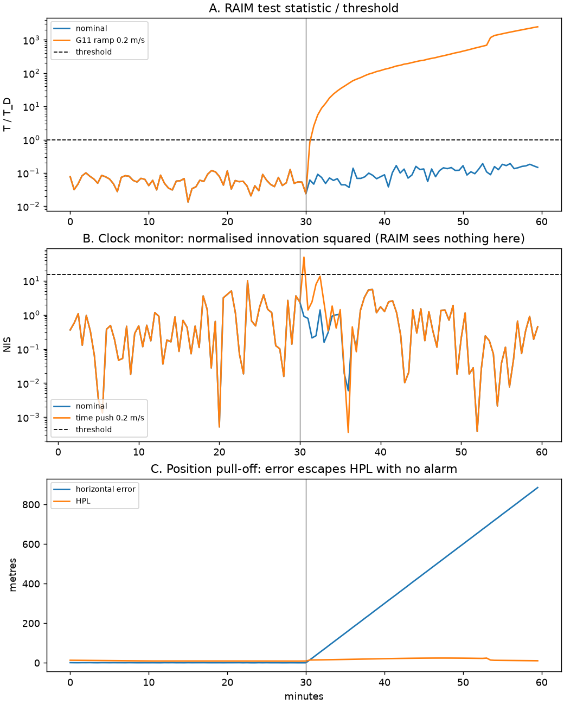
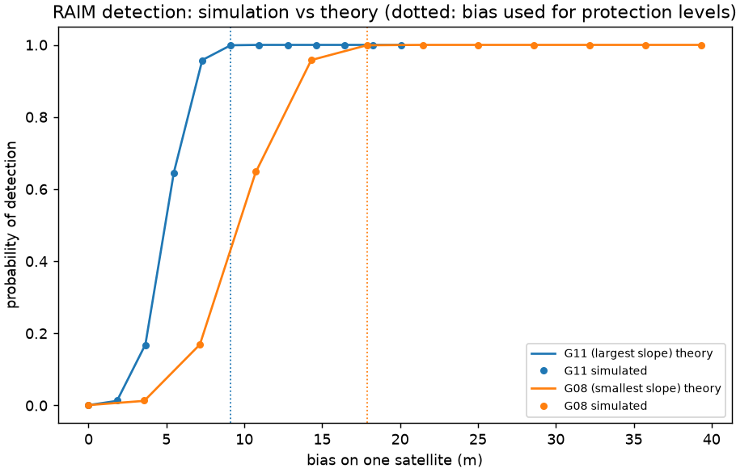

# GNSS Integrity Lab

Receiver autonomous integrity monitoring (RAIM) and a receiver-clock spoofing monitor,
implemented from first principles in Python and tested on real GPS data with injected
faults and spoofing attacks.

The aim is to show, with numbers, what each monitor can and cannot see:

| Threat | Snapshot RAIM | Clock monitor |
|---|---|---|
| Single-satellite fault (drifting range) | Detects and excludes | Partly (the fault leaks into the clock estimate) |
| Time push (all ranges shifted equally) | **Blind** | Detects ramps ≥ 0.1 m/s |
| Position pull-off with a consistent clock | **Blind** | **Blind** |

The last row is why operational receivers add an independent reference such as an
inertial cross-check.



## Data

One hour of dual-frequency GPS at 30 s from GSI station 0759 (Japan), 2 April 2005, with
the matching broadcast ephemeris, as distributed with [RTKLIB](https://github.com/tomojitakasu/RTKLIB).
Faults are injected into the real pseudoranges, so geometry, noise, multipath and the
receiver's own clock are all real.

## Results

**Fault-free performance** (single-frequency L1, broadcast ionosphere, 10° mask)
- Mean horizontal error 0.40 m (max 0.91 m); mean vertical error 0.53 m (max 2.2 m)
- No RAIM alarms in 120 epochs at P_fa = 1e-5; HPL 9–24 m, VPL 14–65 m, always bounding the error
- Error model calibrated from the data: σ² = 0.44² + (0.41 / sin el)² m², including a 1.25× overbound

**A. Single-satellite ramp (G11, 0.2 m/s from t = 30 min)**
- Detected after 60 s, at 12 m of bias
- G11 correctly excluded in 51 of 58 alarmed epochs, a healthy satellite never; the other 7
  epochs were ambiguous and reported as alarms with no position rather than guessed
- Largest error in any position actually output: 6.2 m, never above the HPL without an alarm.
  An unmonitored receiver reaches 357 m.

**B. Time push (every pseudorange shifted by the same ramp)**
- The RAIM test statistic changes by ~1e-9: the attack is absorbed by the clock unknown
- The clock monitor alarms within one epoch (30 s) for ramps of 0.1 m/s (0.33 ns/s) and above
- Ramps of 0.05 m/s and below are not detected: they are smaller than the oscillator's natural wander

**C. Position pull-off at 0.5 m/s with a consistent clock**
- No RAIM alarms, no clock alarms; the error reaches 885 m while the HPL reports 11 m

**Monte Carlo check against theory** (real geometry, 7 satellites, simulated noise)



- 400,000 fault-free trials: empirical P_fa = 9.9e-4 against a design value of 1e-3
- Detection probability vs bias matches the non-central χ² prediction to within 0.003
- At the bias the HPL is built from, the fault goes undetected in 1.0e-3 of trials, matching P_md

Full numbers: [`results/real_data_summary.md`](results/real_data_summary.md),
[`results/monte_carlo_summary.md`](results/monte_carlo_summary.md).

## Lessons from building it

1. **Exclusion can remove the wrong satellite.** The first version excluded the satellite
   whose removal gave the smallest test statistic. With six satellites, several subsets can
   pass, and at one epoch it removed a healthy satellite and output a 184 m error. Exclusion
   is now accepted only when exactly one subset passes; otherwise the epoch is an alarm.
2. **One noise model does not fit two monitors.** RAIM needs overbounded sigmas, which put
   the clock estimate's standard deviation at 1.37 m. Its actual scatter is 0.41 m, so a clock
   monitor using the least-squares covariance was three times too insensitive. It now
   estimates its own noise from second differences.
3. **Oscillators drift.** A two-state clock model tuned on the first half-hour raised 11 false
   alarms in the second, because the receiver's frequency offset moved by about 8 ppb over the
   hour. A third state (drift rate) removed them, validated on data the model was not tuned on.

## Method

| Module | What it does |
|---|---|
| `rinex.py` | Minimal RINEX 2.x GPS observation and navigation reader |
| `orbits.py` | Broadcast orbit and clock (IS-GPS-200), Earth-rotation correction, geodesy |
| `corrections.py` | Klobuchar ionosphere, Saastamoinen troposphere with the DO-229 mapping function, error model |
| `solver.py` | Measurement preparation and weighted least squares |
| `raim.py` | χ² fault detection, exclusion, slope-based protection levels |
| `clock_monitor.py` | Three-state clock Kalman filter with per-epoch and windowed innovation tests |
| `faults.py` | Satellite ramp, time push and position pull-off injection |
| `pipeline.py` | End-to-end processing and error-model calibration |

**RAIM.** With WLS sensitivity S = (GᵀWG)⁻¹GᵀW and residuals r = (I − GS)y, the statistic
T = rᵀWr is χ² with N − 4 degrees of freedom when fault-free. A bias b on satellite i makes it
non-central with λ = b²(1 − P_ii)/σ_i², where P = GS, and moves the position by S_i·b. The
protection level is the largest error per unit √λ over all satellites ("slope") times the √λ
that is missed with probability P_md. This is the classic slope form, which bounds the
fault-induced error only.

**Clock monitor.** The receiver clock is modelled as bias, drift and drift rate driven by white
noise. Its process noise is tuned on clean data so the normalised innovation squared (NIS)
averages 1, then frozen. Alarms come from a per-epoch χ²(1) test on the NIS and a 10-epoch
χ²(10) window test.

## Run it

```bash
pip install -r requirements.txt
python scripts/get_sample_data.py      # downloads the two RINEX files into data/
python experiments/run_real_data.py    # scenarios A-C, writes results/
python experiments/run_monte_carlo.py  # validation against theory
python -m pytest                       # 11 tests
```

## Limitations and next steps

- GPS only, single frequency, snapshot RAIM. Advanced RAIM (ARAIM) with multi-constellation,
  dual-frequency measurements is the modern equivalent.
- One hour of data from one station. The clock monitor was tuned on 30 minutes; a fielded
  monitor would be tuned on many days and temperatures.
- Faults are injected in software; real spoofing also distorts signal tracking, which this
  measurement-level model does not capture.
- Next: an Allan-variance clock test, an inertial consistency check for the pull-off case, and
  longer multi-constellation datasets (IGS/CORS stations, the Norwegian Jammertest data).

## References

- B. W. Parkinson and P. Axelrad, "Autonomous GPS integrity monitoring using the pseudorange residual," *Navigation*, 1988.
- R. G. Brown, "A baseline GPS RAIM scheme and a note on the equivalence of three RAIM methods," *Navigation*, 1992.
- R. G. Brown and G. Y. Chin, "GPS RAIM: calculation of thresholds and protection radius using chi-square methods," ION, 1998.
- T. Walter and P. Enge, "Weighted RAIM for precision approach," *Proc. ION GPS-95*, 1995.
- R. G. Brown and P. Y. C. Hwang, *Introduction to Random Signals and Applied Kalman Filtering*.
- IS-GPS-200, Navstar GPS Space Segment / Navigation User Interfaces.
- RTCA DO-229, MOPS for GPS/SBAS airborne equipment (tropospheric mapping function).
- A. Joseph et al., "GNSS Radio Frequency Interference Mitigation in Collins Commercial Airborne Receivers," *Engineering Proceedings* 54, 2023 (ENC 2023): clock-based and inertial-consistency spoofing monitors that motivated scenarios B and C.

## Licence

MIT. Sample data courtesy of GSI Japan via RTKLIB.
